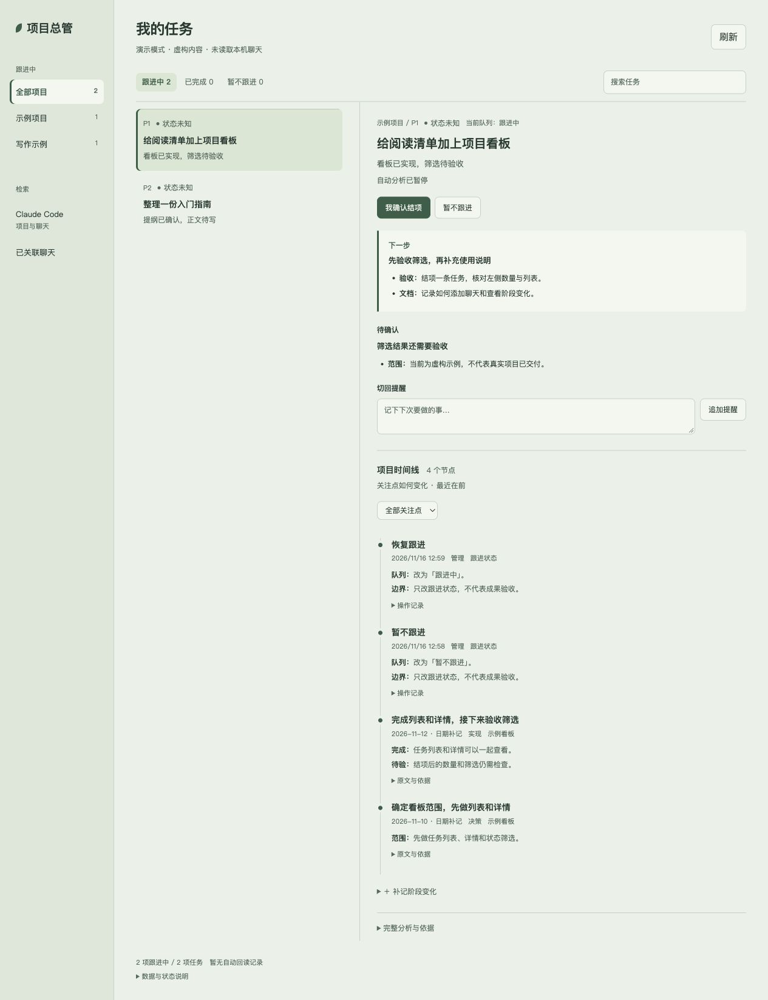

# 项目总管 · Project Manager

把分散在 Codex、Claude Code 里的项目，整理成一个本地看板：**现在进行到哪了、下一步做什么、还有什么待确认。**

Python 标准库 + SQLite + 原生 JavaScript。没有前端打包流程，没有第三方运行依赖。



## 能做什么

- **集中跟进**：项目、任务、跟进中 / 已完成 / 暂不跟进；左侧只显示当前筛选下非零项目。
- **实时状态**：继承猫老大只读 trace 接口，Codex / Claude 共用一个增量订阅，再通过 SSE 更新页面。
- **阶段时间线**：记录想法、调研、决策、实现、验证和阻塞；粒度比 Git 提交粗，每个节点一句总结、几项短句。
- **结构化切回卡**：目标、进度、下一步、待确认；长原文折叠保留，不用截断冒充摘要。
- **Claude 检索**：按项目、聊天标题与正文搜索本机记录，保留搜索和展开状态。
- **可选自动回读**：明确开启后，跟进中的 Codex 聊天整轮结束才分析增量，更新进度与时间线。失败保留旧结果并有限重试。
- **提醒和留痕**：追加提醒、置顶、手动阶段节点、队列变更记录、本地导出。

**请求结束 ≠ 对话整轮结束 ≠ 用户验收结项。** 系统永不自动结项。

### 优先顺序与恢复跟进

- **进行中优先，其余最近结束在前**：项目侧栏、任务列表、已关联聊天、Claude项目和会话共用一套排序。无结束时间则使用最近记录，未知时间保持原顺序；“全部项目”始终置顶。
- **按筛选范围排序**：项目由当前队列和搜索内最高优先的任务决定位置，零值项目仍隐藏。排序不改跟进、暂停或结项状态。
- **不把心跳当结束**：只采用保存轮次的真实结束时间；网关HTTP结束和快照时间不是整个对话完成时间。断线、快照过期或本机运行记录过期后撤销进行中优先。
- **不打断当前工作**：实时状态只移动列表节点，保留已选详情、提醒焦点、搜索词和Claude展开项，不为排序重新检索历史。
- **恢复后仍看得到任务**：从已完成或暂停点击“恢复跟进”，核实后端状态后切到跟进中并定位该任务。保存失败不切换；刷新失败等下次核实，不重复提交。只有已不能匹配该任务的搜索会被清空；用户在等待期间主动切换页面时不强行拉回。

## 先体验，不接触私人数据

需要 Python 3.9+，macOS 或 Linux；Windows 使用 WSL。系统需有 IANA 时区数据（Linux 通常为 `tzdata`）。

```sh
python3 app.py serve --demo --port 8767
```

打开 <http://127.0.0.1:8767/>。演示内容完全虚构：**不读取本机聊天、不连接猫老大、不调用模型**。支持筛选、结项、提醒和手动时间线操作；记录保存在被 Git 忽略的 `demo-data/`。演示和真实数据目录不能混用。

## 接入自己的聊天

在项目目录执行；以下 `CHAT_ID` 要替换成 discover 输出的真实 ID。

```sh
python3 app.py discover
python3 app.py track codex:CHAT_ID
python3 app.py serve
```

打开 <http://127.0.0.1:8766/>。`track` 支持多个 ID，也接受 `claude:CHAT_ID`。初次启动为空白看板，不会自动导入全部聊天。`discover` 是用户主动发起的本机扫描，输出标题与来源 ID；不要公开其输出。

默认读取当前用户的 `.codex/`、`.claude/`、`.config/catboss/`。可选择其他来源根目录和独立的数据目录：

```sh
MANAGER_SOURCE_HOME=/path/to/source-home python3 app.py discover
MANAGER_SOURCE_HOME=/path/to/source-home python3 app.py track codex:CHAT_ID --data-dir /path/to/private-data
MANAGER_SOURCE_HOME=/path/to/source-home python3 app.py serve --data-dir /path/to/private-data
```

`--data-dir` 在后续命令中需保持一致。`track` 建议在服务停止时运行，避免与正在进行的管理操作交叉。

来源兼容性：当前 Codex 适配器依赖 `state_5.sqlite`、`thread_history_1.sqlite` 和 rollout 文件，且只筛选 `model_provider='catboss'` 的聊天。Claude 适配器读取 `.claude/projects/*/*.jsonl`。这些是本机内部格式，产品升级后可能变化；不兼容会显示错误，不能保证兼容所有版本或云端会话。

## 猫老大接口继承

默认接入：

```text
http://127.0.0.1:3425/v1/catboss/trace
```

端口不同时：

```sh
CATBOSS_TRACE_URL=http://127.0.0.1:YOUR_PORT/v1/catboss/trace python3 app.py serve
```

只允许无凭据的本机 HTTP 地址，不经过代理、不跟随重定向。首次获取快照，之后使用 `?after=<seq>&wait=1` 长轮询；多个页面和后台分析共享订阅，不重新请求模型来检测运行状态。

**本仓库包含接口适配器，不包含猫老大服务、路由账号、密钥或网关源码。** 需要已有的猫老大提供该接口。断线会清理旧实时状态并回退到本机保存记录，不能把保存记录当作实时心跳。详见 [接口约定](docs/catboss-api.md)。

## 自动分析与隐私

默认关闭。在页脚「数据与状态说明」里主动开启后：

1. 仅处理白名单内、处于「跟进中」的 Codex 聊天；排除 ID 为 `manager` 的总管自身。
2. 等待保存的整轮完成事件和最终回复，稳定后加入队列；不是根据 HTTP 200 推断完成。
3. 使用 PATH 中的 `codex exec --ephemeral`，复用现有 Codex 身份与模型接入；请求只读、禁工具、插件和网络搜索。
4. 检查结构、字数和引用；结果、时间线、游标在同一 SQLite 事务提交。失败不覆盖旧进度。

**开启后会产生真实模型调用，聊天文字会发送到你现有 Codex 配置的模型服务，可能收费。** 纯状态订阅不调用模型。把总管自身加入时，请在 `analysis.json` 中使用 `manager` ID，或保持该任务「暂不跟进」，避免自我分析循环。

首次登记的内容作为未分析基线；自动回读用于后续完成的轮次，不保证自动补齐所有历史。需要完整历史摘要时，应先手动回读整理 `analysis.json`。自动分析目前不处理 Claude 聊天，Claude 仅支持记录检索、实时请求状态和手动跟进。

服务运行时后台分析可继续工作，关闭网页不会停止；退出 Python 服务即停止。没有安装开机自启或定时任务。工具禁用和输出审计属于防御措施，不是独立安全隔离承诺；不可信聊天内容不能作为指令执行。

## 数据放在哪里

默认在 `data/`（可用 `--data-dir` 改变）：

| 文件 | 用途 |
| --- | --- |
| `总管.sqlite3` | 队列、提醒、自动分析、游标、时间线和任务快照 |
| `tracking.json` | 明确的跟进白名单 |
| `analysis.json` | 人工分析基线；自动结果作为覆盖层，不改原文件 |
| `timeline.json` | 人工回读的历史节点 |
| `analysis_settings.json` | 自动回读开关和参数 |
| `next_steps.json` / `confirmations.json` | 可选的短摘要；按原文指纹校验 |
| `review-runs/` | 自动回读临时目录，正常执行结束后清理 |

```sh
python3 app.py scan
python3 app.py export
```

导出只保存在同一私人数据目录。源码仓库不提供任意目录下载；页面仅服务固定静态文件和受控 API。

`.gitignore` 不会自动脱敏：**不要强制添加数据、真实截图或日志**。模式目录、数据库和导出已默认排除。分享前仍需检查 `git diff --cached`。

## 测试

测试额外需要 Node.js 22+，不需要 npm 安装。使用虚构记录与临时目录，不需要模型或猫老大账号。

```sh
PYTHONDONTWRITEBYTECODE=1 python3 -m unittest discover -s tests -p 'test_*.py'
node --test tests/*.test.js
```

## 源码维护与已有数据

以后从同一个关联本仓库的 Git 工作区开发、测试和提交；旧发布副本仅作历史备份。接用现有看板时，使用 `python3 app.py serve --data-dir /path/to/existing-private-data` 指向原数据目录，不需要搬迁私人资料。源代码、静态页面和模型 schema 从当前仓库加载，旧目录中的数据继续留在原处。

提交前运行 `python3 check_source_tree.py` 检查 Git 索引，再人工审查暂存文件。可用 `git config --local core.hooksPath .githooks` 启用本克隆的提交前检查；这不是完整脱敏或安全审计。详细的备份、切换、拉取和发布步骤见 [维护说明](docs/maintenance.md)。

## 放到个人主页

本项目适合以「项目介绍 + 源码链接 + 匿名演示截图」展示。**GitHub Pages 不能运行 Python 后端或访问你的本机猫老大、聊天库。** 不要把本地看板公开代理到互联网。

服务只绑定回环地址，并做 Host、同源写入令牌和 CSP 检查；它不是带多用户登录鉴权的互联网服务。同一台机器上能发请求的程序仍可能访问数据，请只在可信个人设备上运行。

发布源码不包含任何实际聊天与私人项目记录。此仓库暂未附加开源许可证。

---

**English summary:** A local-first project dashboard for Codex and Claude Code. It combines explicit tracking, a shared read-only CatBoss trace subscription, milestone timelines, concise next steps, and optional model-assisted reviews after completed Codex turns. Run `python3 app.py serve --demo --port 8767` for an entirely fictional, offline demo. Real data remains local unless you explicitly enable model reviews, which send selected conversation text to your configured model provider. The backend is not deployable to GitHub Pages.
